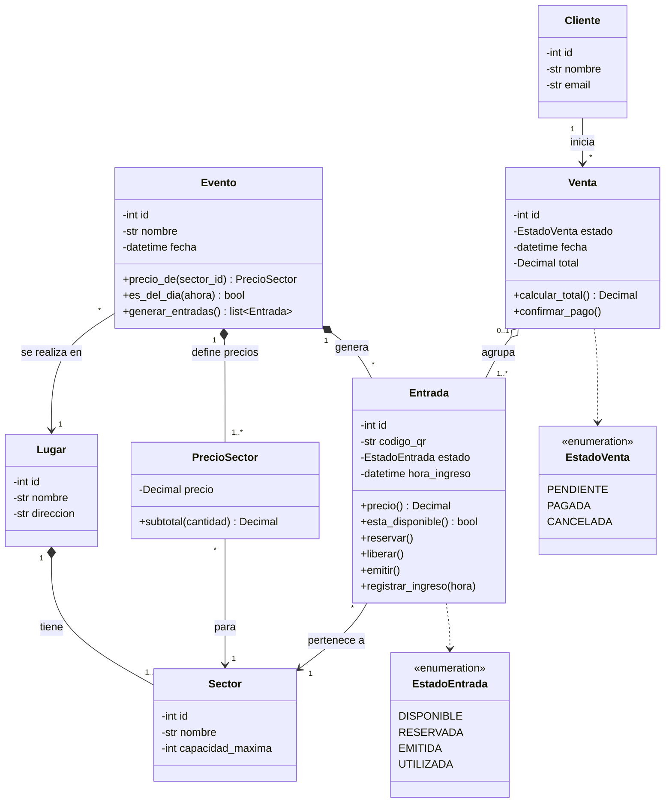
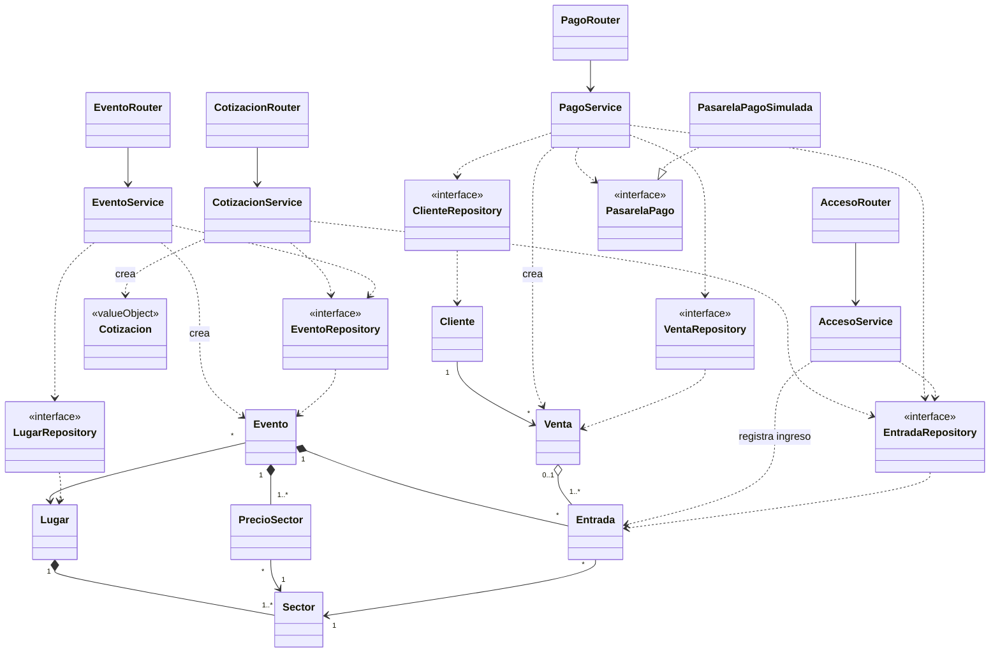
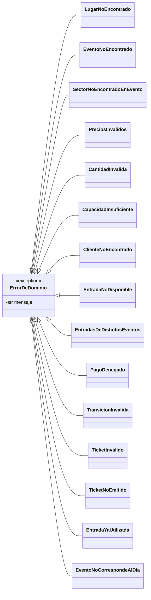

# TP9 - SmartTicket: Diagramas de clases

Tres vistas del mismo modelo: dominio, capas y conjunto. Un cuarto diagrama muestra las excepciones. Los diagramas describen el código implementado para HU1, HU2 y HU3 (carpeta `smartticket/`).

## Decisiones de diseño

- La cotización **no se persiste**: es un objeto de valor (`Cotizacion`) con el total y los ids de las entradas elegidas. El cliente reenvía esos ids al pagar.
- Las transiciones de `Entrada` y `Venta` se validan dentro de cada clase, con enums (sin patrón State).
- Los routers de los casos de uso (`/cotizar`, `/iniciar-pago`, `/escanear-acceso`, `POST /eventos`) no validan nada: delegan en un servicio. `ManejadorExcepciones` traduce cada `ErrorDeDominio` a su código HTTP con la tabla `CODIGO_HTTP`.
- Los routers de lugares, sectores y clientes, y los `GET` de eventos, son CRUD de soporte: usan la sesión de base de datos directamente y responden con `HTTPException`. No pasan por servicio ni repositorio y no se dibujan en las vistas.
- Los routers son módulos de FastAPI con funciones; se dibujan como clases para mostrar sus dependencias. Las funciones `get_*` son los proveedores que FastAPI resuelve con `Depends`. `ManejadorExcepciones` es el módulo `manejador_excepciones.py`: `registrar(app)` instala el handler `manejar`.
- El servicio de pago verifica la disponibilidad de las entradas **antes** de consultar a la pasarela, y las reserva antes de cobrar.
- Las operaciones que no admiten carreras son **atómicas en el repositorio**, con un `UPDATE` condicional y control de `rowcount`: `EntradaRepository.reservar` (`WHERE estado = DISPONIBLE`) y `EntradaRepository.registrar_ingreso` (`WHERE estado = EMITIDA`). Si no coincide, se hace `rollback` y se lanza la excepción de dominio.
- El reloj se inyecta en `AccesoService` (`get_reloj`). La entidad recibe la hora como parámetro y no conoce el reloj del sistema.
- La regla de la tarjeta rechazada (`TARJETA_RECHAZADA`) vive solo en `PasarelaPagoSimulada`.

## Vista 1: Dominio

### Lectura del diagrama

- `Entrada` conoce a su `Evento` (relación bidireccional con la composición `genera`). Por eso `Entrada.precio()` le pregunta el precio del sector a `Evento.precio_de()`, y `Venta.calcular_total()` suma `Entrada.precio()` de sus entradas.
- `Entrada.registrar_ingreso(hora)` valida el estado y le pregunta a `Evento.es_del_dia(hora)` si el evento es de hoy.
- `EstadoVenta.CANCELADA` existe en el enum, pero ningún caso de uso implementado lo usa y `Venta` no tiene un método `cancelar()`.

## Vista 2: Capas (routers, servicios, repositorios, pasarela)

```mermaid
classDiagram
    direction TB

    class CotizacionRouter {
        +cotizar(CotizacionRequest) CotizacionResponse
        +get_cotizacion_service() CotizacionService
    }
    class EventoRouter {
        +crear_evento(EventoCreate) EventoRead
        +get_evento_service() EventoService
    }
    class PagoRouter {
        +iniciar_pago(PagoRequest) PagoResponse
        +get_pago_service() PagoService
        +get_pasarela() PasarelaPago
    }
    class AccesoRouter {
        +escanear_acceso(AccesoRequest) AccesoResponse
        +get_acceso_service() AccesoService
        +get_reloj() Callable~datetime~
    }
    class ManejadorExcepciones {
        +registrar(app)
        +manejar(ErrorDeDominio) JSONResponse
    }
    class CotizacionService {
        -EventoRepository eventos
        -EntradaRepository entradas
        +cotizar(evento_id, sector_id, cantidad) Cotizacion
    }
    class EventoService {
        -LugarRepository lugares
        -EventoRepository eventos
        +crear_evento(lugar_id, nombre, fecha, precios) Evento
    }
    class PagoService {
        -ClienteRepository clientes
        -EntradaRepository entradas
        -VentaRepository ventas
        -PasarelaPago pasarela
        +iniciar_pago(cliente_id, entrada_ids, DatosTarjeta) Venta
        -cargar_entradas_disponibles(entrada_ids) list~Entrada~
        -liberar(entradas)
    }
    class AccesoService {
        -EntradaRepository entradas
        -Callable~datetime~ reloj
        +escanear_acceso(codigo_qr) Entrada
    }
    class Cotizacion {
        <<valueObject>>
        -Decimal total
        -list~int~ entrada_ids
    }
    class LugarRepository {
        <<interface>>
        +buscar_por_id(int) Optional~Lugar~
    }
    class EventoRepository {
        <<interface>>
        +buscar_por_id(int) Optional~Evento~
        +guardar(Evento) Evento
    }
    class EntradaRepository {
        <<interface>>
        +buscar_disponibles(evento_id, sector_id, cantidad) list~Entrada~
        +buscar_por_ids(list~int~) list~Entrada~
        +reservar(list~Entrada~)
        +guardar(list~Entrada~)
        +buscar_por_codigo_qr(str) Optional~Entrada~
        +registrar_ingreso(Entrada)
    }
    class VentaRepository {
        <<interface>>
        +guardar(Venta) Venta
    }
    class ClienteRepository {
        <<interface>>
        +buscar_por_id(int) Optional~Cliente~
    }
    class LugarRepositorySQL
    class EventoRepositorySQL
    class EntradaRepositorySQL
    class VentaRepositorySQL
    class ClienteRepositorySQL
    class DatosTarjeta {
        <<valueObject>>
        -str numero
        -str titular
    }
    class RespuestaPago {
        <<valueObject>>
        -bool aprobado
    }
    class PasarelaPago {
        <<interface>>
        +procesar_pago(DatosTarjeta, Decimal) RespuestaPago
    }
    class PasarelaPagoSimulada {
        +procesar_pago(DatosTarjeta, Decimal) RespuestaPago
    }

    CotizacionRouter --> CotizacionService
    EventoRouter --> EventoService
    PagoRouter --> PagoService
    PagoRouter ..> DatosTarjeta : crea
    AccesoRouter --> AccesoService
    CotizacionService ..> EventoRepository
    CotizacionService ..> EntradaRepository
    CotizacionService ..> Cotizacion : crea
    EventoService ..> LugarRepository
    EventoService ..> EventoRepository
    PagoService ..> ClienteRepository
    PagoService ..> EntradaRepository
    PagoService ..> VentaRepository
    PagoService ..> PasarelaPago
    AccesoService ..> EntradaRepository
    PasarelaPago ..> DatosTarjeta
    PasarelaPago ..> RespuestaPago
    PasarelaPagoSimulada ..|> PasarelaPago
    LugarRepositorySQL ..|> LugarRepository
    EventoRepositorySQL ..|> EventoRepository
    EntradaRepositorySQL ..|> EntradaRepository
    VentaRepositorySQL ..|> VentaRepository
    ClienteRepositorySQL ..|> ClienteRepository
```

### Lectura del diagrama

- Cada router arma su servicio en una función `get_*` con `Depends`: crea el repositorio SQL con la sesión y se lo pasa al servicio por constructor. Los servicios solo conocen las interfaces.
- `get_pasarela()` devuelve `PasarelaPagoSimulada`: cambiar de pasarela implica cambiar solo ese proveedor. `get_reloj()` devuelve `datetime.now`: los tests lo reemplazan por un reloj fijo.
- `Callable~datetime~` abrevia `Callable[[], datetime]`: una función sin parámetros que devuelve la hora actual.
- `EntradaRepository.guardar` recibe una lista y no devuelve nada. Se usa solo para persistir la liberación de entradas cuando el pago falla.

## Vista 3: Conjunto (capas conectadas con el dominio)

Es una vista **simplificada**: muestra solo qué clase de cada capa usa a qué clase del dominio, sin atributos ni métodos. Para no duplicar las vistas 1 y 2, omite:

- los atributos y métodos de todas las clases (vistas 1 y 2);
- las implementaciones `*RepositorySQL`, los value objects `DatosTarjeta` y `RespuestaPago`, `ManejadorExcepciones` y los proveedores `get_*` (vista 2).

Lo que solo aparece acá son las relaciones entre capas y dominio: `EventoService` crea `Evento`, `PagoService` crea `Venta` y `AccesoService` registra el ingreso de `Entrada`.

## Excepciones de dominio

Se lanzan desde las entidades, los servicios y dos repositorios (`EntradaRepository.reservar` y `registrar_ingreso`). Los routers de los casos de uso no tienen `if` de validación: `ManejadorExcepciones` las traduce a HTTP con la tabla `CODIGO_HTTP` (si una excepción no figura, responde 400).

| Excepción | Historia | Lanzada por | Mensaje (en el código) | HTTP |
|---|---|---|---|---|
| `LugarNoEncontrado` | Alta de evento | `EventoService.crear_evento` | Lugar no encontrado | 404 |
| `PreciosInvalidos` | Alta de evento | `EventoService.crear_evento` | Debe definirse un precio para cada sector del lugar, sin repetir ni agregar otros | 400 |
| `EventoNoEncontrado` | HU1 | `CotizacionService.cotizar` | Evento no encontrado | 404 |
| `SectorNoEncontradoEnEvento` | HU1 | `Evento.precio_de` | El sector no tiene precio definido en este evento | 404 |
| `CantidadInvalida` | HU1 E3 | `CotizacionService.cotizar` | Cantidad inválida | 400 |
| `CapacidadInsuficiente` | HU1 E2 | `CotizacionService.cotizar` | Capacidad insuficiente | 400 |
| `ClienteNoEncontrado` | HU2 | `PagoService.iniciar_pago` | Cliente no encontrado | 404 |
| `EntradasDeDistintosEventos` | HU2 | `PagoService.iniciar_pago` | Las entradas deben pertenecer a un mismo evento | 400 |
| `EntradaNoDisponible` | HU2 E3 | `PagoService`, `Entrada.reservar`, `EntradaRepository.reservar` | Los lugares seleccionados ya no se encuentran disponibles | 409 |
| `PagoDenegado` | HU2 E2 | `PagoService.iniciar_pago` | Pago denegado | 402 |
| `TransicionInvalida` | HU2 | `Entrada.liberar`, `Entrada.emitir`, `Venta.confirmar_pago` | Transición de estado inválida | 409 |
| `TicketInvalido` | HU3 E3 | `AccesoService.escanear_acceso` | Ticket Inválido o Inexistente | 404 |
| `TicketNoEmitido` | HU3 E4 | `Entrada.registrar_ingreso` | Ticket no emitido / Falta de pago | 400 |
| `EntradaYaUtilizada` | HU3 E2 | `Entrada.registrar_ingreso`, `EntradaRepository.registrar_ingreso` | Entrada ya utilizada | 409 |
| `EventoNoCorrespondeAlDia` | HU3 (decisión de diseño) | `Entrada.registrar_ingreso` | La entrada no corresponde al evento del día | 400 |

Los mensajes de `CantidadInvalida` y `CapacidadInsuficiente` son más cortos que los del enunciado ("La cantidad de entradas solicitadas debe ser mayor a cero" y "Capacidad insuficiente o entradas no disponibles"), que además difieren entre la sección 3 y el prompt de la sección 6. Hay que confirmar con el docente cuál usar. La validación de "evento del día" no figura entre los escenarios del enunciado: se agregó por decisión de diseño.

## Dónde se aplica GRASP y SOLID

| Principio | Dónde |
|---|---|
| Information Expert | `PrecioSector.subtotal()` y `Evento.precio_de()` conocen los precios. `Entrada.precio()` y `Venta.calcular_total()` calculan con lo que tienen. `Evento.es_del_dia()` sabe si es el día del evento. `Entrada` valida sus propias transiciones de estado (`reservar`, `liberar`, `emitir`, `registrar_ingreso`). |
| Creator | `Evento.generar_entradas()`: el evento crea sus entradas. |
| Controller | Un servicio por caso de uso (`CotizacionService`, `PagoService`, `AccesoService`, `EventoService`). El router de cada caso de uso solo recibe y responde. |
| Pure Fabrication | Servicios y repositorios: no existen en el dominio, pero mantienen la cohesión. |
| Indirection | Los repositorios están entre los servicios y la base de datos. `ManejadorExcepciones` está entre las excepciones de dominio y HTTP. |
| Protected Variations / Polymorphism | `PasarelaPago`: la pasarela real puede reemplazar a la simulada. El reloj inyectado en `AccesoService` aísla la hora del sistema. |
| High Cohesion / Low Coupling | Cada entidad maneja lo suyo; los servicios dependen de interfaces. |
| SRP | Router solo HTTP, servicio solo orquesta, entidad solo su comportamiento, repositorio solo persistencia (incluida la atomicidad de `reservar` y `registrar_ingreso`). |
| OCP | Se agrega otra pasarela sin modificar `PagoService`: solo cambia el proveedor `get_pasarela`. |
| LSP | Cualquier `PasarelaPago` es intercambiable, igual que cualquier implementación de un repositorio. |
| ISP | Hay una interfaz de repositorio por agregado (`Lugar`, `Evento`, `Entrada`, `Cliente`, `Venta`). Es parcial: `EntradaRepository` reúne los métodos de tres casos de uso. |
| DIP | Los servicios reciben por constructor las interfaces de los repositorios, `PasarelaPago` y el reloj. Los proveedores `get_*` de los routers arman las implementaciones concretas. |
