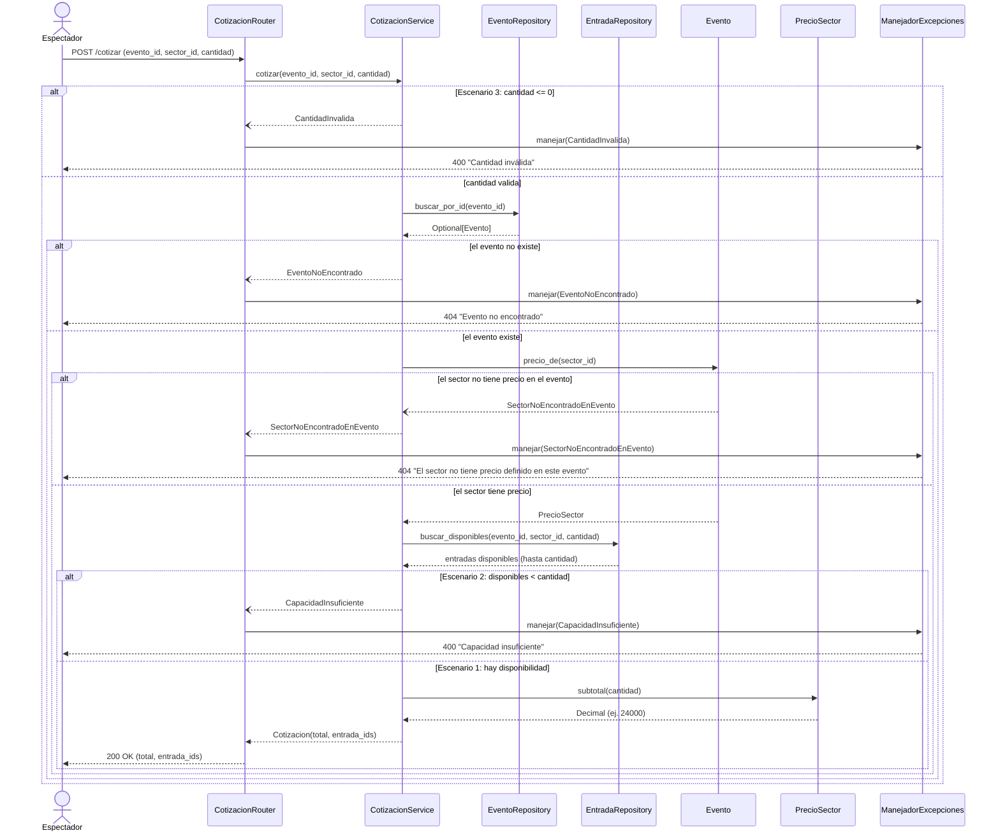
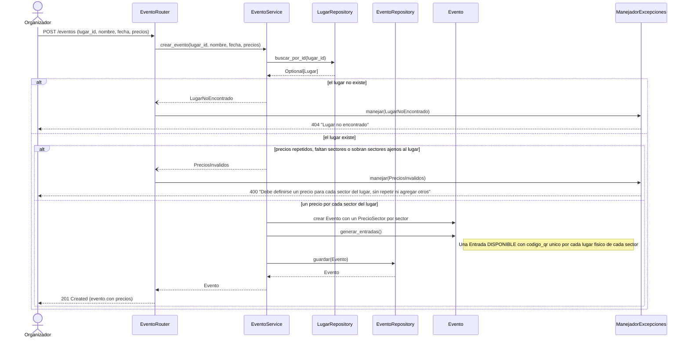

# TP9 - SmartTicket: Secuencia HU1 (Selección y Cotización)

## Lectura del diagrama

- El router solo recibe la petición y devuelve la respuesta (`CotizacionResponse`). No tiene `if` ni cálculos.
- La validación de la cantidad y de la disponibilidad está en `CotizacionService`.
- El orden es: cantidad, evento, **precio del sector** y recién después la disponibilidad. Un sector sin precio en el evento se informa antes de consultar las entradas.
- El subtotal lo calcula `PrecioSector`, que es quien conoce el precio (Information Expert). `Evento.precio_de()` lo busca entre los precios del evento.
- La cotización **no reserva ni modifica** las entradas: solo las identifica. La reserva ocurre al pagar (HU2).
- Los errores son excepciones de dominio. `ManejadorExcepciones` las traduce a HTTP.
- El mensaje del enunciado para estos errores es más largo ("La cantidad de entradas solicitadas debe ser mayor a cero" y "Capacidad insuficiente o entradas no disponibles"). El código usa los textos cortos que se ven en el diagrama; falta confirmar con el docente cuál usar.

## Prerrequisito: alta del evento

Las entradas que cotiza HU1 existen porque el evento las genera al crearse. Este flujo no es una historia del enunciado, pero es el que deja el inventario listo.

- `Evento.generar_entradas()` aplica Creator: el evento crea sus entradas, una por cada lugar de la capacidad máxima de cada sector.
- `EventoService` verifica que haya exactamente un precio por cada sector del lugar antes de crear nada.
