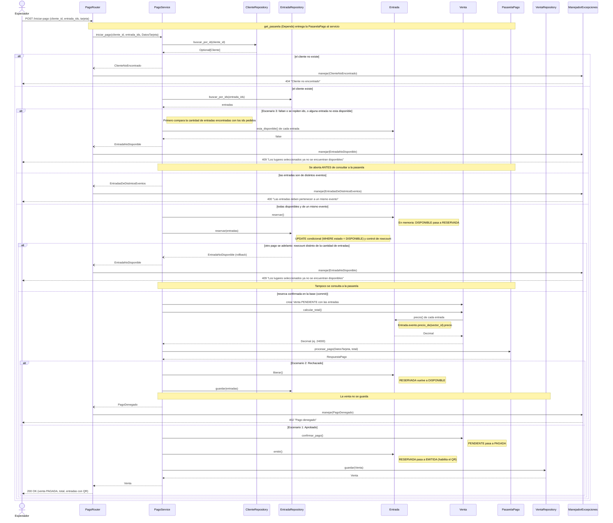

# TP9 - SmartTicket: Secuencia HU2 (Pago y Emisión de Entradas)

## Lectura del diagrama

- El router arma un `DatosTarjeta` con los datos de la tarjeta del pedido y llama a `iniciar_pago(cliente_id, entrada_ids, DatosTarjeta)`. `PagoRequest` es un esquema HTTP y el servicio no lo conoce.
- El servicio **verifica la disponibilidad antes de llamar a la pasarela** (escenario 3): si falta una entrada, un id está repetido o alguna ya no está disponible, aborta sin tocar nada. Si no, se cobraría por entradas que ya no existen.
- También valida que todas las entradas sean del mismo evento (`EntradasDeDistintosEventos`), porque una venta corresponde a un solo evento.
- Se **reserva** antes de cobrar, para que nadie más tome esas entradas mientras se procesa el pago.
- Si la pasarela rechaza, se **libera**, se guardan las entradas como disponibles y la venta no se guarda: es el escenario 2. Si la pasarela lanza un error inesperado, el servicio también libera las entradas y vuelve a lanzar el error.
- `Venta.calcular_total()` suma `Entrada.precio()`, y cada entrada le pregunta el precio a su `Evento`. Se calcula con la venta ya armada, antes de cobrar.
- Cada cambio de estado lo valida la propia entidad (`Entrada`, `Venta`): si la transición es inválida, lanza `TransicionInvalida`.
- La pasarela es una interfaz. El servicio no sabe si es la simulada o una real (DIP). `get_pasarela` con `Depends` es el único lugar que elige la implementación, y los tests la reemplazan.

## Reserva atómica (resuelto)

`Entrada.reservar()` valida el estado en memoria, y eso solo no alcanza si dos clientes pagan las mismas entradas a la vez: ambos podrían pasar la verificación. La solución implementada es `EntradaRepository.reservar(entradas)`, que ejecuta un `UPDATE` condicional:

- Cambia a `RESERVADA` solo las filas con `estado = DISPONIBLE` y compara el `rowcount` con la cantidad de entradas pedidas.
- Si no coincide, otro pago se adelantó: hace `rollback` y lanza `EntradaNoDisponible`, así que la reserva es todas o ninguna.
- Si coincide, hace `commit` y recién entonces el servicio arma la venta y consulta a la pasarela.
