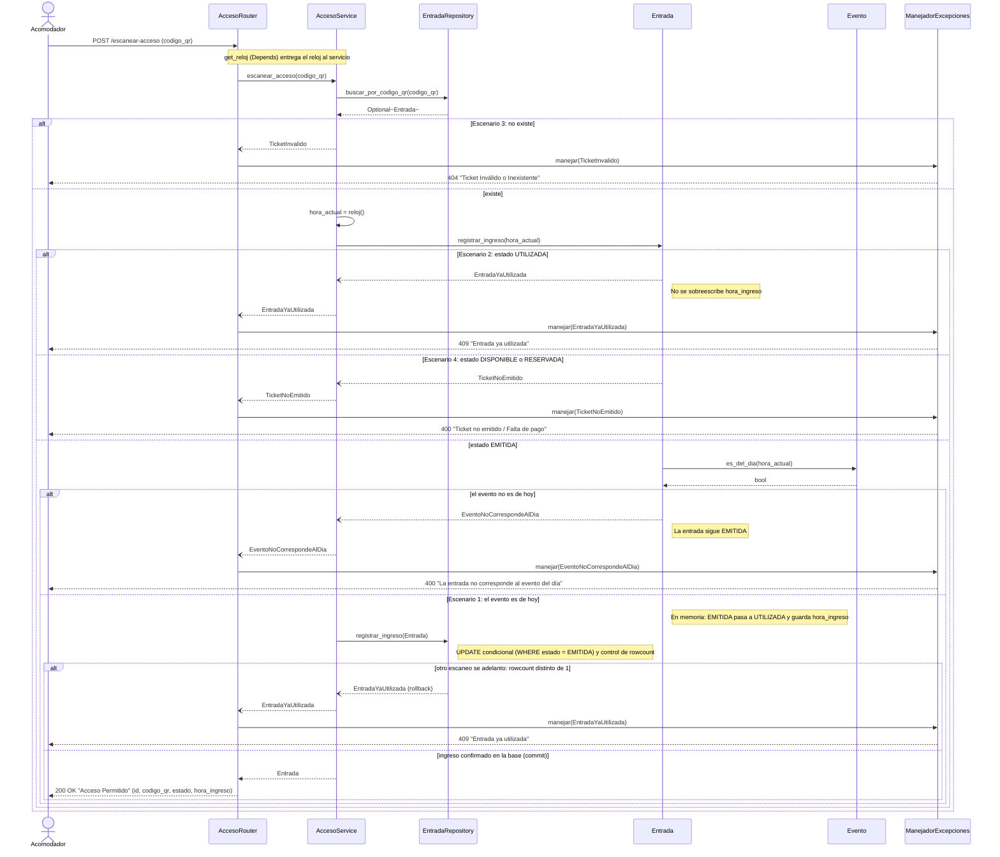

# TP9 - SmartTicket: Secuencia HU3 (Control de Acceso en Puerta)

## Lectura del diagrama

- El servicio no decide si la entrada es válida para entrar: se lo pregunta a `Entrada`, que es quien conoce su estado (Information Expert).
- `Entrada.registrar_ingreso()` valida en este orden: **estado primero, fecha del evento después**. Si es `UTILIZADA` lanza `EntradaYaUtilizada`; si no es `EMITIDA` lanza `TicketNoEmitido`; si el evento no es de hoy lanza `EventoNoCorrespondeAlDia`; si pasa los tres controles, pasa a `UTILIZADA` y guarda `hora_ingreso`. No hay `if` por estado en el servicio. Con el chequeo del código QR, el orden completo es: QR, estado, fecha.
- Cuando se rechaza, la entrada no se modifica, así que la hora de ingreso original queda intacta.
- El reloj es un `Callable` inyectado en `AccesoService` (`get_reloj` con `Depends`). El servicio obtiene la hora y se la pasa a la entrada, que se la pasa a `Evento.es_del_dia()`. Así las entidades no dependen del reloj del sistema y los tests fijan la hora.
- Al rechazar, `Entrada` lanza la excepción dentro de `registrar_ingreso()` y el servicio no llega a llamar al repositorio.

## Ingreso atómico

`Entrada.registrar_ingreso()` solo cambia el estado en memoria. Si dos acomodadores escanean el mismo QR a la vez, ambos podrían pasar el control. Por eso `AccesoService` persiste con `EntradaRepository.registrar_ingreso(entrada)` y no con `guardar`:

- Ejecuta un `UPDATE` condicional que pasa a `UTILIZADA` y guarda la hora solo si la fila sigue `EMITIDA`, y exige `rowcount == 1`.
- Si el `rowcount` es 0, otro escaneo se adelantó: hace `rollback` y lanza `EntradaYaUtilizada`, sin pisar la hora de ingreso del primero.

## Evento del día

El enunciado menciona "QR correspondiente al evento del día", pero ningún escenario lo valida. Por decisión de diseño se implementó: `Evento.es_del_dia(ahora)` compara la fecha del evento con la fecha de la hora recibida, y su rechazo (`EventoNoCorrespondeAlDia`, 400) no cambia el estado de la entrada.
